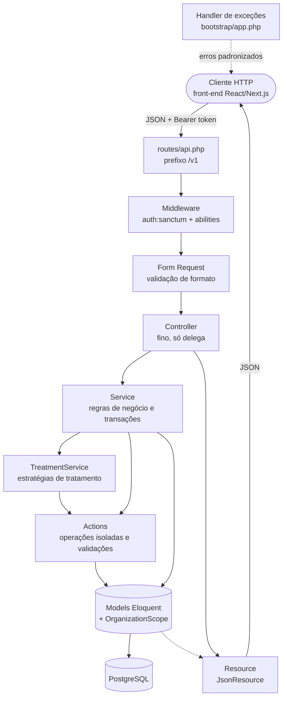
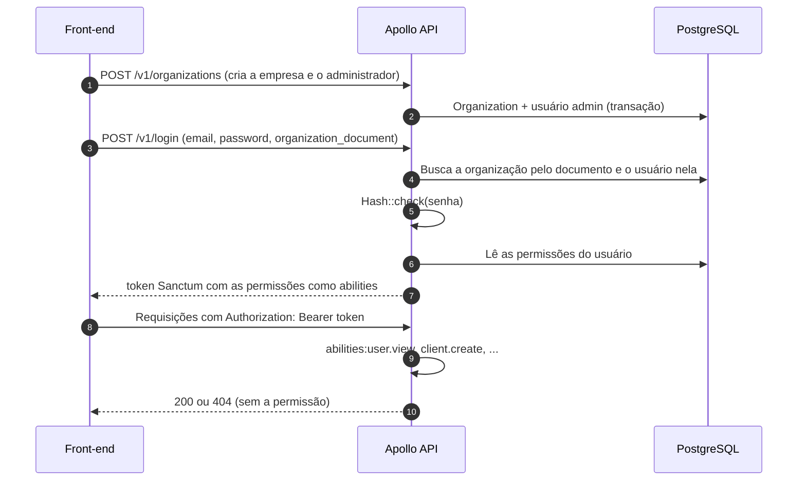
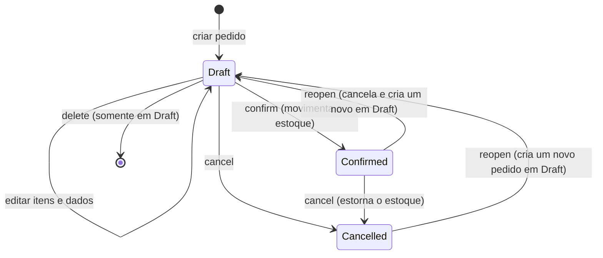
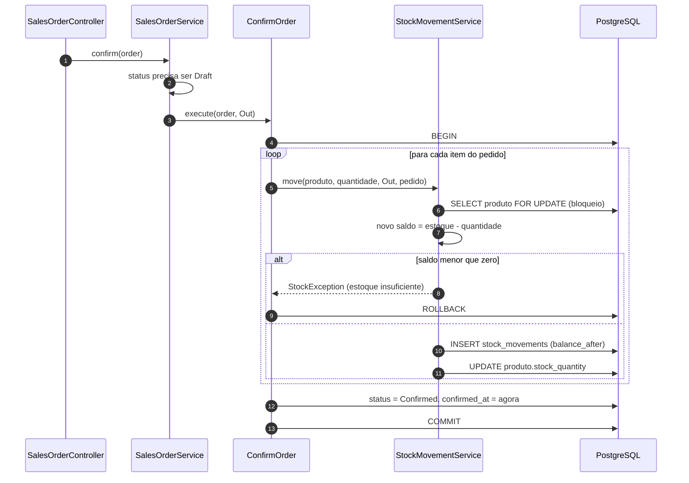
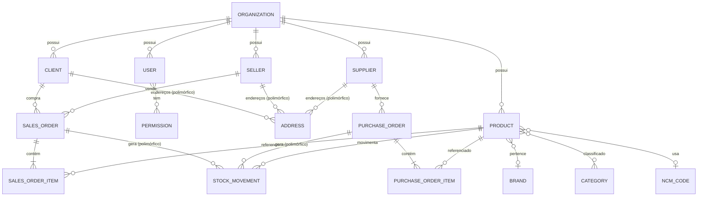

# Apollo API

API REST de um ERP multiempresa (multi-tenant) para pequenos negócios brasileiros, desenvolvida em **Laravel**. Cobre cadastros (clientes, vendedores, fornecedores, produtos, marcas e categorias), pedidos de venda e de compra com controle de estoque e sincronização da tabela NCM.

Este documento descreve a arquitetura e o funcionamento do back-end.

---

## 1. Visão geral

| Item                  | Tecnologia                                             |
| --------------------- | ------------------------------------------------------ |
| Linguagem / framework | PHP 8.2+ (CI em 8.4) / Laravel 13                      |
| Banco de dados        | PostgreSQL                                             |
| Autenticação          | Laravel Sanctum (token Bearer com _abilities_)         |
| Valores monetários    | `brick/money` encapsulado em um _Value Object_ próprio |
| Documentação da API   | Scramble (OpenAPI)                                     |
| Testes                | Pest (Feature e Unit)                                  |
| Qualidade             | Laravel Pint, Husky e Commitlint                       |
| CI/CD                 | GitHub Actions (testes, lint e migrations)             |
| Deploy                | Vercel (`vercel-php`)                                  |
| Ambiente local        | Docker Compose (PostgreSQL 17 e Redis 7)               |

O front-end é um projeto separado (React/Next.js) que consome esta API por HTTP, em arquitetura cliente-servidor com servidores de front-end e back-end independentes.

---

## 2. Arquitetura

O back-end segue o padrão **MVC** do Laravel, adaptado a uma API: como não há renderização de telas, a camada _View_ é substituída pelos **Resources** (`JsonResource`), que serializam os Models em JSON. Sobre o MVC foram adicionadas as camadas de **Service** e **Action**, para manter os Controllers enxutos e isolar as regras de negócio.



### 2.1 Camadas

| Camada                | Pasta                           | Responsabilidade                                                                                                                                                |
| --------------------- | ------------------------------- | --------------------------------------------------------------------------------------------------------------------------------------------------------------- |
| Rotas                 | `routes/api.php`                | Define os endpoints sob `/v1` e agrupa as rotas autenticadas com `auth:sanctum`.                                                                                |
| Middleware            | `app/Http/Middleware`           | `abilities` e `ability` verificam as permissões do token e respondem **404** (e não 403) quando o acesso é negado.                                              |
| Form Requests         | `app/Http/Requests`             | Validam o formato dos dados de entrada, organizados por recurso.                                                                                                |
| Controllers           | `app/Http/Controllers/Api/V1`   | Recebem a requisição, chamam o Service e devolvem a resposta. Declaram as permissões exigidas por método via `HasMiddleware`.                                   |
| Services              | `app/Services`                  | Concentram as regras de negócio. `BaseService` é a base comum e cada recurso tem o seu (ex.: `SalesOrderService`). Controlam as transações (`DB::transaction`). |
| TreatmentService      | `app/Services/TreatmentService` | Padrão **Strategy** para normalizar e validar campos. Há estratégias como `TreatDocument`, `TreatEAN`, `TreatNCM`, `TreatMoney`, `TreatNumber` e `TreatArray`.  |
| Actions               | `app/Actions`                   | Classes de uma única operação, separadas em `Validation/`, `Order/` (`ConfirmOrder`, `CancelOrder`) e `Fetch/Ncm`.                                              |
| Models                | `app/Models`                    | Entidades Eloquent com ULID/UUID, _soft deletes_, _casts_ e escopo por organização.                                                                             |
| Resources             | `app/Http/Resources`            | Transformam os Models em JSON e incluem relacionamentos apenas quando carregados (`whenLoaded`).                                                                |
| Value Objects e Casts | `app/ValueObjects`, `app/Casts` | `Money` e o cast `AsMoney`.                                                                                                                                     |
| Enums                 | `app/Enum`                      | Permissões, status de pedido e pagamento, tipo de movimento de estoque e códigos de erro.                                                                       |
| Exceptions            | `app/Exceptions`                | Hierarquia baseada em `BaseException` com mensagens traduzidas.                                                                                                 |

---

## 3. Funcionamento

### 3.1 Ciclo de uma requisição

1. O cliente envia a requisição para `/v1/...` com o token no cabeçalho `Authorization: Bearer`.
2. O middleware `auth:sanctum` identifica o usuário e `abilities:<permissão>` confere se o token possui a permissão exigida pelo método do Controller.
3. O **Form Request** valida o formato dos dados.
4. O **Controller** chama o **Service** correspondente.
5. O Service trata os campos pelo `TreatmentService`, aplica as regras de negócio, executa Actions e persiste os dados em transação.
6. O Controller responde com um **Resource** ou com o envelope `{ "message", "data" }`.
7. Qualquer exceção é convertida em JSON pelo `Handler`, em um formato único:

```json
{
    "error": {
        "code": "VALIDATION_ERROR",
        "message": "...",
        "fields": { "campo": ["mensagem"] }
    }
}
```

Os valores de `code` vêm do enum `ErrorType` (ex.: `UNAUTHENTICATED`, `FORBIDDEN`, `NOT_FOUND`, `VALIDATION_ERROR`, `DUPLICATE_FIELD`, `INSUFFICIENT_STOCK`, `INVALID_STATUS_TRANSITION`, `INTERNAL_ERROR`). O campo `fields` aparece apenas em erros de validação.

### 3.2 Autenticação e permissões



- O login exige o **documento da organização**, além de e-mail e senha, porque o mesmo e-mail pode existir em empresas diferentes.
- As permissões do usuário viram as _abilities_ do token e usam notação com ponto (`client.create`, `sales_order.update` etc.), definidas em `PermissionType`.
- Ao criar uma organização, o `OrganizationObserver` inicializa os contadores de numeração sequencial dela.

### 3.3 Multi-tenancy (isolamento por empresa)

Cada empresa é uma `Organization`, e os dados de negócio carregam `organization_id`.

- O `OrganizationScope`, aplicado nos Models com `#[ScopedBy]`, adiciona automaticamente `WHERE organization_id = <organização do usuário autenticado>` em todas as consultas.
- A trait `ProtectsOrganization` impede alterar o `organization_id` de um registro existente.
- A trait `HasSequencialNumber` atribui a cada registro um número sequencial **por organização e por tabela** (ex.: pedido nº 1, 2, 3 de cada empresa).
- Regras de validação como `Rule::exists()` não passam pelos _global scopes_ do Eloquent, então devem filtrar `organization_id` explicitamente.

### 3.4 Valores monetários

Dinheiro nunca é manipulado como `float`:

- No banco, os valores ficam em colunas `NUMERIC` com 4 casas decimais.
- O Value Object `Money` (sobre `brick/money`, moeda BRL, arredondamento _half-up_) oferece `add`, `subtract` e `multiply`.
- O cast `AsMoney` converte entre a coluna e o `Money`, e rejeita qualquer valor que não seja `Money` ao gravar.
- Nos Resources, os valores saem como string decimal (ex.: `"1500.0000"`), sem perda de precisão.

### 3.5 Pedidos e estoque

Existem pedidos de **venda** (`SalesOrder`) e de **compra** (`PurchaseOrder`), cada um com seus itens. Os dois compartilham as interfaces `MovesStock` e `HasStatus` e as Actions `ConfirmOrder` e `CancelOrder`.



**Regras principais**

- Só pedidos em `Draft` podem ser editados ou excluídos.
- Ao criar um item de venda, o preço unitário vem de `Product::sale_price`; o valor enviado pelo cliente não é usado. Nos pedidos de compra, o preço informado é aceito.
- A edição de itens usa um diff com `to_add`, `to_update` e `to_remove`.
- **Reabrir** um pedido não altera o original: ele é cancelado (se ainda estiver confirmado) e um novo pedido em `Draft` é criado com `replaces_order_id` apontando para o anterior. Assim o histórico de estoque nunca é reescrito. Os itens mantêm o preço negociado, e a resposta traz `outdated_prices` com os produtos cujo preço atual mudou.

**Confirmação de um pedido de venda**



- `StockMovement` é um registro de **movimentação**, ligado ao pedido por relação polimórfica (`reference`), e guarda o saldo após cada movimento (`balance_after`).
- O `lockForUpdate()` evita que duas confirmações simultâneas vendam o mesmo estoque.
- O cancelamento de um pedido **confirmado** gera o movimento inverso; o de um pedido em `Draft` apenas muda o status.

### 3.6 Sincronização da tabela NCM

O job `SyncNcmTableJob` é agendado diariamente em `routes/console.php`. Ele usa as Actions de `Fetch/Ncm` para consultar a tabela NCM e atualizar `ncm_codes`, que os produtos referenciam. Os códigos são validados pela estratégia `TreatNCM`.

---

## 4. Modelo de dados (resumo)



---

## 5. Endpoints (`/v1`)

| Recurso                                                                     | Rotas                                                                                                                     |
| --------------------------------------------------------------------------- | ------------------------------------------------------------------------------------------------------------------------- |
| Organização e login                                                         | `POST /organizations`, `POST /login`, `POST /logout`                                                                      |
| Usuários, clientes, vendedores, fornecedores, marcas, categorias e produtos | CRUD: `GET /`, `GET /{id}`, `POST /`, `PATCH /{id}`, `DELETE /{id}`                                                       |
| Endereços de cliente, vendedor e fornecedor                                 | `POST /{recurso}/{id}/addresses`, `GET /{recurso}/{id}/addresses`, `PATCH /{recurso}/{id}/addresses/{address}/setDefault` |
| Endereços                                                                   | `GET`, `PATCH` e `DELETE /addresses/{address}`                                                                            |
| Pedidos de venda e de compra                                                | CRUD e, em `/sales-orders/{id}` e `/purchase-orders/{id}`: `PATCH /confirm`, `PATCH /cancel`, `PATCH /reopen`             |

A especificação completa (OpenAPI) é gerada pelo Scramble.

---

## 6. Testes, qualidade e CI/CD

- **Testes (Pest):** `tests/Feature` cobre Services, Actions, Jobs, comandos e a API v1. `tests/Unit` cobre Value Objects, Casts, Enums, Rules e Helpers. Para rodar: `composer run test`, que sobe o Docker, aplica as migrations de teste e executa a suíte.
- **Lint:** `composer run lint:check` (Pint). O Husky e o Commitlint padronizam os commits.
- **GitHub Actions:**
    - `tests.yaml`: roda a suíte em _pull requests_;
    - `list.yaml`: confere o estilo de código com o Pint em _pull requests_;
    - `migrate.yaml`: aplica as migrations no banco de produção a cada _push_ na `main`.
- **Deploy:** a API roda na Vercel pelo builder `vercel-php`, com `api/index.php` como ponto de entrada.

---

## 7. Como executar localmente

```bash
git clone https://github.com/jhimyferrari/apollo-api-laravel.git
cd apollo-api-laravel
composer install
cp .env.example .env
php artisan key:generate

# sobe PostgreSQL e Redis, espera o banco, migra e inicia a aplicação
composer run dev
```

Requisitos: PHP 8.2+, Composer, Docker e Node.js (para o Vite).

---

## 8. Estrutura de pastas

```
app/
├── Actions/            # operações isoladas (Validation/, Order/, Fetch/Ncm)
├── Casts/              # AsMoney
├── Enum/               # permissões, status, tipos de movimento e de erro
├── Exceptions/         # BaseException, Handler e exceções de domínio
├── Http/
│   ├── Controllers/Api/V1/
│   ├── Middleware/     # abilities / ability
│   ├── Requests/       # Form Requests por recurso
│   └── Resources/      # JsonResources
├── Interfaces/         # HasStatus, MovesStock e outras
├── Jobs/               # SyncNcmTableJob
├── Models/             # entidades e Scopes/OrganizationScope
├── Observers/          # OrganizationObserver
├── Policies/
├── Rules/              # CpfAndCnpj, StrongPassword
├── Services/           # Services por recurso + TreatmentService/
├── Traits/             # HasAddresses, HasSequencialNumber, ProtectsOrganization
└── ValueObjects/       # Money
database/migrations/    # esquema do banco
routes/api.php          # rotas da API v1
tests/                  # Feature e Unit (Pest)
development-infra/      # docker compose (PostgreSQL e Redis)
```

---

## Licença

Distribuído sob a licença MIT.
